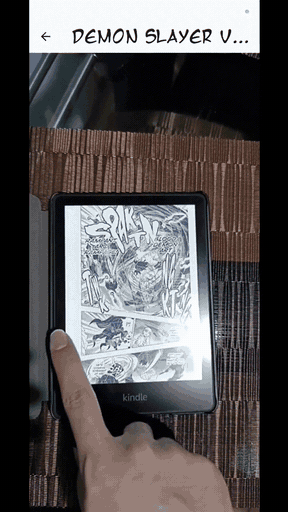

# Manga AR Experience 📖✨

Manga AR Experience is a **Flutter-based mobile application that brings manga panels to life through Augmented Reality**. By integrating the Unity engine with Vuforia, the app lets users scan physical manga pages and view associated AR content, creating an immersive and interactive reading experience.

> Aplicación móvil hecha en **Flutter** que da vida a las páginas de manga mediante **Realidad Aumentada**: escanea una página física y mira su contenido AR generado en Unity + Vuforia.

## 📸 Screenshots

| Pick a series | Pick a volume | AR content in action |
| --- | --- | --- |
|  |  |  |

*Del carrusel de series al tomo elegido — y el escaneo de una página física disparando el contenido AR.*

## ✨ Features

- **Manga series carousel** — browse available manga series on the home screen.
- **Volume selection** — choose a specific manga volume to explore.
- **Augmented reality** — scan designated manga panels to trigger AR effects and animations.
- **Unity integration** — seamless transition from the Flutter UI to a Unity-powered AR view.
- **Optimized loading** — Unity is pre-loaded in the background for a smooth, fast transition to AR.

## 🛠 Technologies used

| Layer | Tech |
| --- | --- |
| Frontend | [Flutter](https://flutter.dev/) |
| AR engine | [Unity](https://unity.com/) + [Vuforia](https://developer.vuforia.com/) |
| Unity ↔ Flutter bridge | [`flutter_unity_widget`](https://pub.dev/packages/flutter_unity_widget) |
| UI | [`carousel_slider`](https://pub.dev/packages/carousel_slider), `StatefulWidget` / `StatelessWidget` |

## 🚀 Getting started

### Prerequisites

- [Flutter SDK](https://docs.flutter.dev/get-started/install)
- [Unity Hub](https://unity.com/download) with a compatible Unity version installed
- An IDE with the Flutter plugin (Android Studio / VS Code)
- A physical Android device (AR target detection requires the camera)

### Installation

1. **Clone the repository:**
   ```sh
   git clone https://github.com/JoshuaLopez2000/mangaARExperience.git
   cd mangaARExperience
   ```
2. **Set up the Unity project:**
   - Open `unity/MangaAR` in Unity Hub.
   - Ensure the **Vuforia Engine AR** package is installed via the Package Manager.
   - Build the Unity project for Android and/or iOS to generate the native files Flutter consumes. See the official `flutter_unity_widget` documentation for export steps.
3. **Run the Flutter app:**
   ```sh
   flutter pub get
   flutter run
   ```

## 🗂 Project structure

```
.
├── android/            # Android native project
├── assets/             # Images and fonts for the Flutter app
├── ios/                # iOS native project
├── lib/
│   ├── data/           # Data sources (manga lists)
│   ├── models/         # Dart models (MangaSeries, MangaVolume)
│   ├── views/          # UI screens and widgets
│   └── main.dart       # App entry point
├── test/               # Flutter tests
├── unity/MangaAR/      # Embedded Unity (Vuforia) project
└── pubspec.yaml
```

## 📄 License

Distributed under the MIT License. See [`LICENSE.md`](LICENSE.md) for details.
